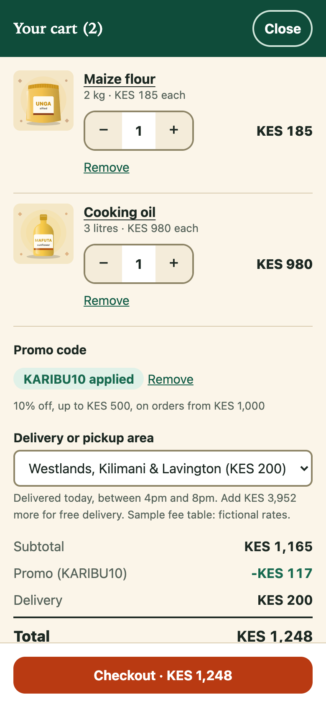
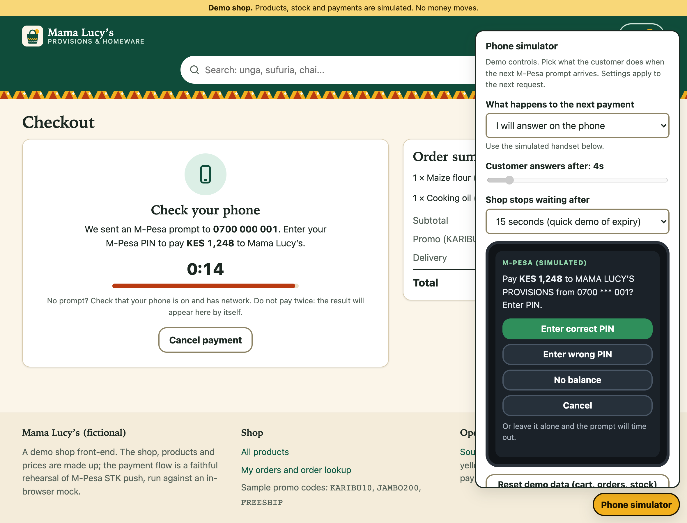
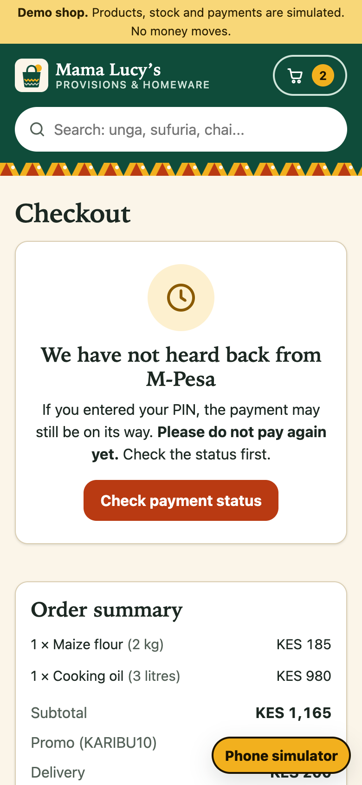
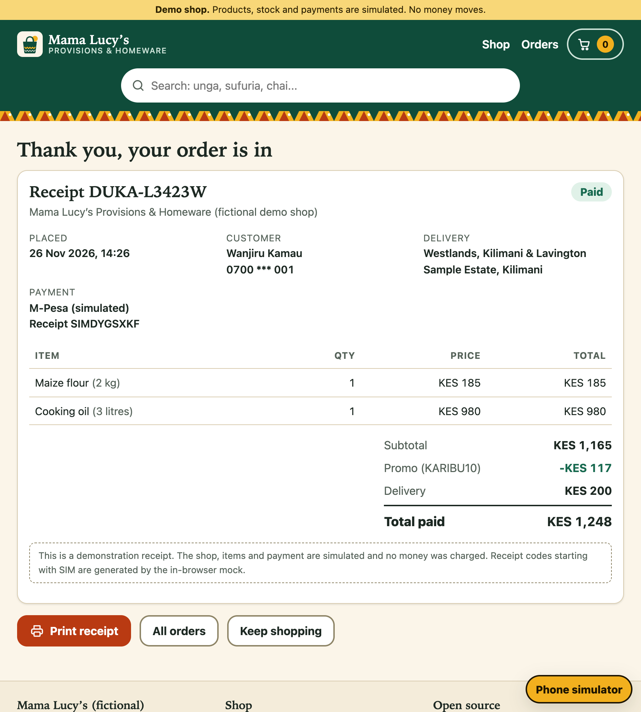
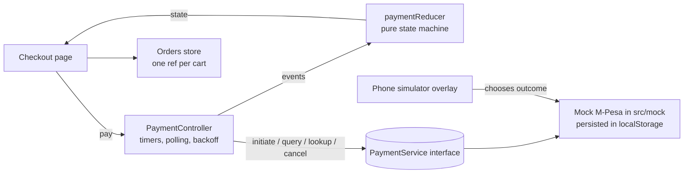

# Duka Storefront

**Live demo: https://victor-wambua.github.io/duka-storefront/**

A fast, accessible, mobile-first shop front-end for a small Kenyan retailer, with a checkout built around **M-Pesa STK push**: the way customers actually pay.

[](https://github.com/Victor-Wambua/duka-storefront/actions/workflows/ci.yml)
[](LICENSE)


> **Payments are simulated.** The shop, products, prices and stock are fictional ("Mama Lucy's Provisions & Homeware"). M-Pesa is played by an in-browser mock in `src/mock/`; no real money moves and no network call is made to Safaricom. Status: portfolio build, runs locally with sample data.


## The problem

Generic e-commerce templates assume a card form and a synchronous "paid or declined" answer. In Kenya most people pay with an M-Pesa prompt on their phone, and that is asynchronous: the customer has to pick up the handset, and may cancel, ignore it, mistype the PIN, or lack the balance. Templates handle this badly. The usual symptoms are a spinner that never ends, a second charge when the shopper taps "Pay" again, and an order that was paid for but never recorded.

This project is a working answer to that: the payment is a state machine, every ending has its own screen, retries cannot create a second order or a second charge, and there is a recovery path for "I paid but it still says pending".

## What it does

- **Catalogue.** 41 products in 6 categories, variants (size, colour, pack) with their own price and stock, instant fuzzy search that tolerates typos ("sufria" finds sufuria, "unga" finds maize flour), sorting, category filters, product pages, related items, recently viewed.
- **Pictures drawn in code.** No image files and no external requests: each product is an SVG composition coloured from its palette (or the chosen colour variant).
- **Cart.** Drawer with quantity steppers, stock limits, sample promo codes, delivery by Nairobi area or free pickup with an estimate, totals in whole shillings. Saved in `localStorage` with a schema version and a migration.
- **M-Pesa STK push checkout** (against the mock): live phone-number normalisation (`07xx`, `01xx`, `+254...`), then a payment state machine with a countdown, polling with backoff, and a screen for each ending: paid, cancelled, wrong PIN, insufficient funds, timed out, unreachable, and "no answer in time".
- **No double charge, no duplicate order.** One order reference per cart, one idempotency key per attempt, double-click protection, and a rule that a new prompt is not offered until a status check shows nothing was paid.
- **Recovery.** "Check payment status" looks the payment up by order reference and phone. A reload mid-payment resumes the same prompt.
- **Pay on delivery** (or at pickup) as an alternative, receipts with print styles, order history, and order lookup by reference and phone.
- **Phone simulator.** The yellow button in the corner opens demo controls: choose how the next payment ends, or play the customer on a simulated handset, so every state can be seen without a real phone.
- **PWA.** Installable, offline shell and catalogue, add-to-cart works offline, and checkout explains that it needs a connection.
- **Accessibility.** Landmarks, skip link, focus moved on route change and into/out of the drawer, live regions for cart changes and payment status, keyboard operable, reduced motion, dark mode, axe checks with real colour contrast.

| Cart | Waiting on the phone (with simulator) |
| --- | --- |
|  |  |

| Wrong PIN | No answer, then recovery | Receipt |
| --- | --- | --- |
|  |  |  |

## Quick start

Needs Node 20.19 or newer (CI runs 22 and 24).

```bash
git clone https://github.com/Victor-Wambua/duka-storefront.git
cd duka-storefront
npm ci
npm run dev          # http://localhost:5173/duka-storefront/
```

Sample data is built in; there is nothing to load. Try this: add maize flour, open the cart, pick "Westlands, Kilimani & Lavington", apply `KARIBU10`, check out with phone `0700 000 001`, then use the **Phone simulator** button to pick "Customer cancels" and watch what happens.

```bash
npm run build && npm run preview   # production build (PWA service worker active)
```

## How it works



The payment lives in three layers so each can be tested alone:

1. `src/payment/machine.ts`: a pure reducer. `idle -> requesting -> awaiting_customer -> paid | failed(cancelled | wrong_pin | insufficient_funds | timeout | unreachable) | expired`. Events that make no sense in the current state return the same state object, which is how double-submits and late replies are ignored.
2. `src/payment/controller.ts`: owns time and I/O. Sends the push, polls with backoff (2, 3, 4.5, 6, then every 8 seconds), enforces the wait window, pauses while offline, and drops replies that belong to an older attempt.
3. `src/payment/types.ts`: the `PaymentService` interface. `src/mock/mpesaMock.ts` implements it in the browser. A real implementation would call your own server, which talks to Daraja. The server-side counterpart is my [daraja-php](https://github.com/Victor-Wambua/daraja-php) library.

Money is always an integer number of shillings; percentages round half up using integer arithmetic. More in [docs/CASE-STUDY.md](docs/CASE-STUDY.md).

## Testing

```bash
npm run lint         # ESLint
npm run typecheck    # tsc --noEmit, strict
npm test             # Vitest: unit + component + axe (jsdom)
npm run test:e2e     # Playwright (builds, serves on :4210)
```

Last full run on this repo: **204 Vitest tests in 11 files, all passing; 8 Playwright tests, all passing; ESLint and `tsc` clean.** Playwright needs a browser once: `npx playwright install chromium` (or set `CHROME_PATH` to an existing Chrome).

| Area | What is covered |
| --- | --- |
| Pricing | rounding, promo caps and minimums, free-delivery thresholds, totals always the integer sum of their parts, Nairobi-time delivery estimates |
| Phone numbers | 11 accepted formats, 14 rejections, masking |
| Payment machine | every transition, all five failure reasons, expiry, recovery, double-submit, stray events |
| Controller (fake timers) | backoff schedule, deadline, offline pause, reload resume, stale replies, cancel then retry |
| Mock service | every simulator outcome, idempotency, no stacked prompts, already-paid |
| Cart and persistence | reducer, stock limits, v1 to v2 schema migration, corrupt and future-version data |
| Components (Testing Library) | search, filters, variants, drawer focus, steppers, promo, every checkout state, offline, pay on delivery, order lookup |
| Accessibility | axe in jsdom on shop, product, drawer, checkout, payment panels, orders, receipt (0 violations); axe in Chromium with real colour contrast in light and dark (0 violations) |
| End to end | browse, add, STK success; cancel, retry, success with one order and one payment; reload mid-payment; pay on delivery; offline |

A Lighthouse run (v13, mobile profile with simulated throttling) against the local production build scored 100 for performance, accessibility, best practices and SEO, with LCP 0.8 s and no layout shift. That was a single run on a laptop against `vite preview`, not a field measurement.

**Bundle size** (gzip): shop route about 94 kB JavaScript + 6 kB CSS. Checkout, receipt, orders and the simulator are separate chunks that load on demand (checkout about 7 kB).

## Project layout

```
src/
  payment/    machine.ts (reducer), controller.ts (timers, polling), types.ts (service contract)
  mock/       mpesaMock.ts (fake Safaricom + our server), PhoneSimulator.tsx (demo overlay)
  lib/        money, phone, pricing, search (fuzzy), persist (versioned localStorage)
  state/      cart reducer, orders, stores, cart view
  data/       sample catalogue, delivery fee table, promo codes
  components/ ProductArt (SVG illustrations), CartDrawer, PaymentPanel, ...
  pages/      Shop, Product, Checkout, Order (receipt), Orders (history + lookup)
sw/           service worker source (precache list injected at build)
tests/        Vitest
e2e/          Playwright
docs/         CASE-STUDY.md, screenshots/
```

## Configuration

| Variable | Default | Meaning |
| --- | --- | --- |
| `BASE_PATH` | `/duka-storefront/` | URL base used at build time. Set it when hosting under a different path. |

The router is a hash router on purpose: it works on static hosting under any sub-path with no server rewrites.

## Status and roadmap

Portfolio build. Everything described above exists and is tested. What is **mocked**: the shop, products and stock, the M-Pesa service and the handset, and the receipt codes (they start with `SIM`). Result codes in the mock follow what I know of Daraja's STK callback but were **not checked against the live API**.

Known limits: orders live in one browser only; stock is a local ledger, not a shared inventory; there are no user accounts; the delivery fees and promo codes are samples; the search is a small hand-written matcher, fine for a few hundred products, not thousands.

Next steps:

1. A thin real backend: STK push, callback endpoint and status query against the Daraja sandbox, behind the same `PaymentService` interface.
2. Server-side orders and stock reservation, so two shoppers cannot buy the last item.
3. Swahili translation.
4. Web push for "your order is on its way".
5. Playwright runs on a real mobile browser matrix.

## Author

Built by Victor Wambua: [portfolio](https://victor-wambua.github.io/victor-portfolio/) · [case studies](https://github.com/Victor-Wambua/case-studies)

Licensed under the [MIT License](LICENSE).
