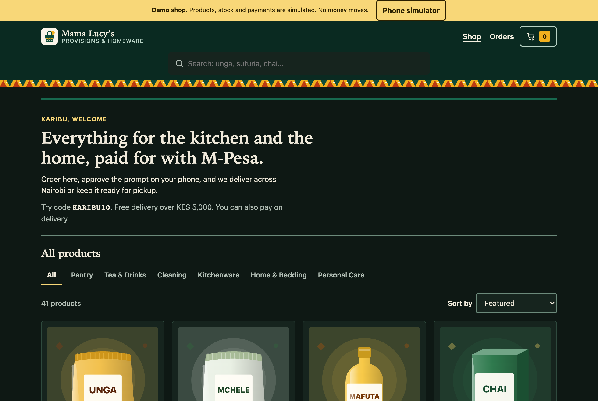
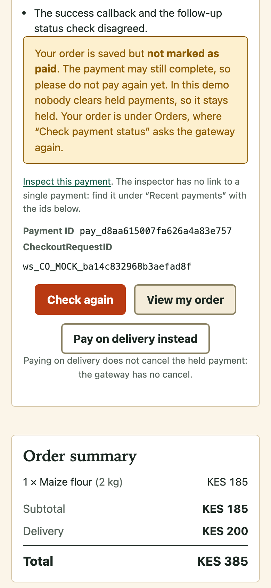
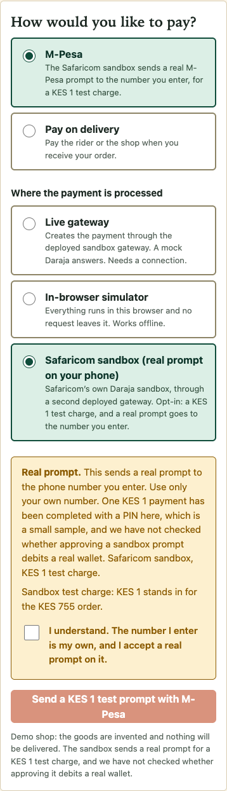
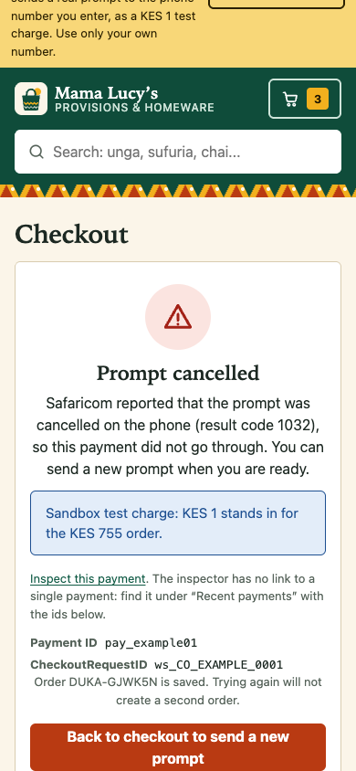
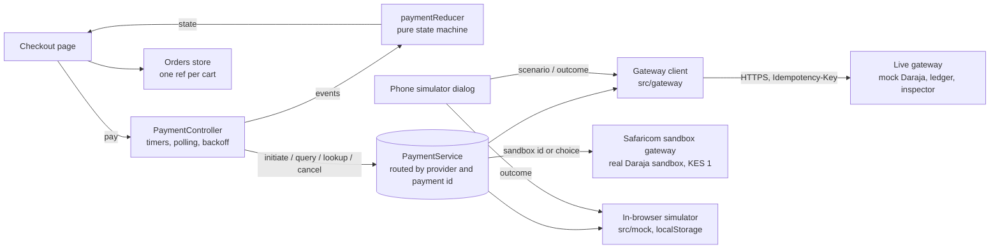

# Duka Storefront

**Live demo: https://victor-wambua.github.io/duka-storefront/**

A fast, accessible, mobile-first shop front-end for a small Kenyan retailer, with a checkout built around **M-Pesa STK push**: the way customers actually pay.

[](https://github.com/Victor-Wambua/duka-storefront/actions/workflows/ci.yml)
[](LICENSE)


> **Static demo, invented data, sandbox payments.** The shop, products, prices and stock are fictional ("Mama Lucy's Provisions & Homeware"). By default the checkout creates its payments on a **live sandbox gateway** ([mpesa-gateway](https://github.com/Victor-Wambua/mpesa-gateway)) whose Daraja side is a **mock**: the payment record, idempotency, status checks and ledger are real, the M-Pesa prompt is not. With those two defaults (the mock-Daraja gateway and the in-browser simulator in `src/mock/`, the offline fallback) no real prompt is sent to any phone, no call is made to Safaricom and no money moves. There is also a **third, opt-in choice that is different**: a Safaricom sandbox provider that sends a **real M-Pesa prompt** to the number you type, for a flat KES 1 test charge, behind a warning and an acknowledgement. One KES 1 payment has been completed with a PIN there (a small sample), and whether approving a sandbox prompt debits a real wallet has not been checked (details under [Live gateway](#live-gateway)). Status: portfolio build.



## The problem

Generic e-commerce templates assume a card form and a synchronous "paid or declined" answer. In Kenya most people pay with an M-Pesa prompt on their phone, and that is asynchronous: the customer has to pick up the handset, and may cancel, ignore it, mistype the PIN, or lack the balance. Templates handle this badly. The usual symptoms are a spinner that never ends, a second charge when the shopper taps "Pay" again, and an order that was paid for but never recorded.

This project is a working answer to that: the payment is a state machine, every ending has its own screen, retries cannot create a second order or a second charge, and there is a recovery path for "I paid but it still says pending".

## What it does

- **Catalogue.** 41 products in 6 categories, variants (size, colour, pack) with their own price and stock, instant fuzzy search that tolerates typos ("sufria" finds sufuria, "unga" finds maize flour), sorting, category filters, product pages, related items, recently viewed.
- **Pictures drawn in code.** No image files and no external requests: each product is an SVG composition coloured from its palette (or the chosen colour variant).
- **Cart.** Drawer with quantity steppers, stock limits, sample promo codes, delivery by Nairobi area or free pickup with an estimate, totals in whole shillings. Saved in `localStorage` with a schema version and a migration.
- **M-Pesa STK push checkout** (mock-Daraja gateway by default, in-browser simulator as the fallback, opt-in Safaricom sandbox): live phone-number normalisation (`07xx`, `01xx`, `+254...`), then a payment state machine with a countdown, polling with backoff, and a screen for each ending: paid, cancelled, wrong PIN, insufficient funds, declined, timed out, held for review, gateway unreachable, rate limited, over the demo cap, and "no answer in time".
- **No double charge, no duplicate order.** One order reference per cart, one idempotency key per attempt, double-click protection, and a rule that a new prompt is not offered until a status check shows nothing was paid.
- **Recovery.** "Check payment status" looks the payment up by order reference and phone. A reload mid-payment resumes the same prompt.
- **Pay on delivery** (or at pickup) as an alternative, receipts with print styles, order history, and order lookup by reference and phone.
- **Phone simulator.** The button in the yellow bar at the top opens a dialog with demo controls (Escape closes it). With the mock-Daraja gateway it is a scenario picker with a one-line explanation of each of the gateway's eight mock outcomes; with the in-browser simulator it also offers a delay slider and a simulated handset. Either way every state can be seen without a real phone. With the Safaricom sandbox there is no picker, because Safaricom decides how the prompt ends.
- **PWA.** Installable, offline shell and catalogue, add-to-cart works offline, and checkout explains that it needs a connection.
- **Accessibility.** Landmarks, skip link, focus moved on route change and into/out of the drawer, live regions for cart changes and payment status, keyboard operable, reduced motion, dark mode, axe checks with real colour contrast.

| Cart | Waiting on the phone (live gateway, scenario picker open) |
| --- | --- |
|  |  |

| Wrong PIN (gateway) | Held for review (gateway) | Gateway unreachable |
| --- | --- | --- |
|  |  |  |

| No answer, then recovery (simulator) | Receipt (gateway payment) |
| --- | --- |
|  |  |

| Safaricom sandbox: warning and acknowledgement | Safaricom sandbox: prompt cancelled (1032) |
| --- | --- |
|  |  |

The sandbox screens are shown against a stubbed gateway (the second one has example payment ids), so they show the wording and layout, not a payment that happened.

## Design notes

- Text is never smaller than 12px, including the lettering drawn on the product pictures. "Popular" and "New" are plain text above the product name, not badges.
- The whole product card is one link; the name link alone is at least 44px tall. Header, footer and breadcrumb links are 44px tall too.
- The category filter is a row of text tabs with the current one underlined and set in bold, and it is marked with `aria-pressed`.
- The checkout summary stays in view beside the form from 960px up. Validation puts the message under each field and moves focus to the first one that needs fixing. No field shows a realistic sample phone number as a placeholder.
- The phone simulator toggle sits in the demo bar, not over the page, so it cannot cover the Pay button or the footer links. The panel is a non-modal dialog with focus on open and on close.
- Not verified: screen reader output (VoiceOver, NVDA, TalkBack). Axe and keyboard checks only.

## Quick start

Needs Node 20.19 or newer (CI runs 22 and 24).

```bash
git clone https://github.com/Victor-Wambua/duka-storefront.git
cd duka-storefront
npm ci
npm run dev          # http://localhost:5173/duka-storefront/
```

Sample data is built in; there is nothing to load. Try this: add maize flour, open the cart, pick "Westlands, Kilimani & Lavington", apply `KARIBU10`, check out with phone `0700 000 001`, then use the **Phone simulator** button to pick "Customer cancels" and watch what happens.

```bash
npm run build && npm run preview   # production build (PWA service worker active)
```

## Live gateway

The checkout has a **payment provider switch** (in the payment section of the form, and at the top of the Phone simulator). The choice is saved in the browser. There are three providers, and the default is the first.

| | Live gateway (default) | In-browser simulator | Safaricom sandbox (opt-in) |
| --- | --- | --- | --- |
| Where the payment is created | `POST /v1/payments` on the deployed [mpesa-gateway](https://github.com/Victor-Wambua/mpesa-gateway) (Cloudflare Worker + D1) | `localStorage`, in this browser | `POST /v1/payments` on a **second** deployment of the same gateway, `gateway-sbx.victorwambua004.workers.dev` |
| Daraja side | A **mock** Daraja with deterministic scenarios. Nothing is sent to Safaricom or to a phone | A pretend handset | **Safaricom's real Daraja sandbox**. A real STK prompt is sent to the number you enter |
| Amount | The order total (cap KES 1,000) | The order total | A flat **KES 1** test charge, never the order total (the sandbox key's cap is KES 100) |
| Scenario picker | Yes (eight mock outcomes) | Outcome and delay controls | **No.** The gateway accepts no `scenario` in sandbox mode |
| Needs a network | Yes | No | Yes |
| Receipt codes | `MOCK...` from the gateway | `SIM...` from the browser | Whatever the gateway reports; none has been seen |

**What is real:** the HTTP API, the Idempotency-Key handling, the payment state machine, the callback and status-query verification, the append-only ledger and the inspector, on both gateway instances. **What is simulated** on the default instance: the M-Pesa prompt and the customer's answer. **On the sandbox instance the prompt is real**, which is why it is opt-in.

### The Safaricom sandbox provider

- **Opt-in only.** The default stays the mock-Daraja gateway. Choosing the sandbox shows, before checkout: "This sends a real prompt to the phone number you enter. Use only your own number. One KES 1 payment has been completed with a PIN here, which is a small sample, and we have not checked whether approving a sandbox prompt debits a real wallet. Safaricom sandbox, KES 1 test charge." The pay button stays disabled until an acknowledgement box is ticked. The tick is **never saved** (the provider choice is, the tick is not) and is cleared each time a prompt is sent, so a retry goes back through the form and it has to be ticked again.
- **Flat KES 1.** Carts are larger than the sandbox cap, so the sandbox is always asked for KES 1. The checkout panel, the confirmation and the receipt say "Sandbox test charge: KES 1 stands in for the KES 620 order" (with the real order total). The order is marked paid only when the gateway reports `succeeded`, and is then labelled **paid (sandbox test)**.
- **Phone.** No pre-filled number and no sample number as a placeholder. The number is validated with the same helper as the rest of the checkout and is stored with the order exactly as before (the receipt masks it). It is never logged.
- **States, from the gateway's real states.** Pending ("Check your phone for an M-Pesa prompt and enter your PIN to approve it, or cancel it. This can take up to 2.5 minutes."), cancelled (ResultCode 1032), timed out ("No response in time", ResultCode 1037), failed (with the Daraja description), held for review (never marked paid, with an explanation) and succeeded. Polling is the same as the mock gateway's (backoff, paused while the page is hidden, `Retry-After` honoured), but the wait window is 210 s because the gateway's prompt timeout is 150 s. A 1037 from Safaricom is treated as final; only a timeout the gateway decided on its own is watched for a late result.
- **When it cannot be used.** `403 phone_not_approved` (an owner-opt-in restriction: the sandbox may accept only approved numbers) says the sandbox is restricted and offers the mock gateway. Unreachable, `429` (with a countdown) and a cap error say so and offer the mock gateway, the in-browser simulator and pay on delivery. If `GET /v1/config` reports `phone_policy: approved_numbers_only`, the form says so up front.
- **What was observed with the real sandbox** (by the owner, with their own phone): the sandbox did send a real STK prompt. Real outcomes seen were **ResultCode 1032** (cancelled by the customer, callback after about 8 s) and **ResultCode 1037** (no response, callback after about 26 s; the gateway maps it to `timed_out`). The owner has also completed **one** payment with a PIN (KES 1, their own number, 2026-11-28): the success callback (`ResultCode 0`, a real receipt) arrived 9 s after the push, the gateway's STK Query answered `500.001.1001` with an empty message the first time and `ResultCode 0` the second, and only then did the gateway mark it `succeeded` and post a balanced journal entry. This storefront has not been used for a PIN payment; that one went through the gateway directly.
- **What is NOT established.** That is **one payment, a small sample**. **This project has not checked whether a sandbox success debits a real wallet.** The checkout's success screen and receipt say so, and the acknowledgement still warns that the prompt reaches a real phone. The tests below cover this storefront's success path only against a stubbed gateway.
- **Payment ids.** The sandbox's ids look like the mock's (`pay_...`), so the app tags the ones it gets from the sandbox (`sbx:pay_...`) in its own storage, which is how a reload or a later order lookup goes back to the right host. The screen and the receipt show the gateway's own id, and the inspector link points at the sandbox instance's inspector.

How the storefront uses it:

- **Reference and idempotency.** The order number (`DUKA-XXXXXX`) is the payment `reference`. One `Idempotency-Key` is made per attempt and saved in the checkout session *before* the request goes out, so a double click or a reload that re-sends the request gets the same payment back (HTTP 200) instead of a second one. A new key is made only when the request body changed or the previous attempt got an answer. If the gateway reports a payment already in flight for the order (`reference_pending`), the checkout follows that one.
- **Polling.** `GET /v1/payments/:id` about every 1.5 s, easing off to 5 s. It stops when the payment is final, pauses while the page is hidden or the browser is offline, and waits out `Retry-After` on a 429.
- **Never paid early.** An order is marked paid only when the gateway says `succeeded`, and the receipt shown is the `mpesa_receipt` from that response. `needs_review` is its own screen ("We are checking this payment"): the order stays unpaid, the visitor is told not to pay again, and can check again, open the order, or choose pay on delivery.
- **Timeouts.** After the gateway marks a payment `timed_out` the checkout keeps watching for 30 s, because a late success moves it to `needs_review` rather than `succeeded`.
- **Inspect this payment.** The gateway's inspector has no deep link to one payment, so the link goes to the inspector home and the page shows the payment id and Daraja `CheckoutRequestID` to find under "Recent payments".
- **Order lookup.** For a gateway order the order page and the orders page ask the gateway by `reference` (`GET /v1/payments?reference=`), only counting a payment whose amount matches the order, and they show "Payment under review" when the gateway is holding it.
- **When the mock gateway cannot be used.** If it is unreachable, rate limited (with the `Retry-After` countdown) or the cart is over the **KES 1,000** cap of the public demo key, the page says so in plain words, changes nothing, and offers the in-browser simulator or pay on delivery.

The Phone simulator's choices map onto the gateway's `scenario` values:

| Choice | `scenario` | Ends as |
| --- | --- | --- |
| Customer pays | `success` | `succeeded` after about 3 s |
| Insufficient funds | `insufficient_funds` | `failed` (code 1) |
| Wrong PIN | `wrong_pin` | `failed` (code 2001) |
| Customer cancels | `cancelled_by_user` | `cancelled` (code 1032) |
| Prompt times out (no callback) | `timeout_no_callback` | `timed_out` after about a minute |
| Duplicate callback | `duplicate_callback` | `succeeded`, recorded once |
| Late success | `late_success` | `timed_out`, then `needs_review` (about two minutes) |
| Callback and query disagree | `callback_then_query_disagree` | `needs_review` |

**Privacy.** The phone number you type is sent to the gateway (it returns it masked). With the mock gateway no real prompt is ever sent, so use a made-up number such as `0700 000 001`. With the Safaricom sandbox, a real prompt goes to that number, so use only your own.

**No secret in this repo.** A static browser app cannot keep a secret. `src/gateway/config.ts` holds the gateway URL and the gateway's *publishable* demo key (`pk_sandbox_...`), which is public by design: it can only create sandbox payments up to KES 1,000, read its own payments, and nothing else. The sandbox instance takes the same publishable key (capped at KES 100 per payment there). Override at build time with `VITE_GATEWAY_URL` and `VITE_GATEWAY_KEY`, and `VITE_SANDBOX_URL` and `VITE_SANDBOX_KEY` for the sandbox. The mock gateway is rate limited to 20 payments a minute per IP and 5 per phone number per 10 minutes; the sandbox to 10 and 3.

## How it works



The payment lives in three layers so each can be tested alone:

1. `src/payment/machine.ts`: a pure reducer. `idle -> requesting -> awaiting_customer -> paid | failed(cancelled | wrong_pin | insufficient_funds | timeout | declined | unreachable | rate_limited | over_cap | rejected) | review | expired`. Events that make no sense in the current state return the same state object, which is how double-submits and late replies are ignored.
2. `src/payment/controller.ts`: owns time and I/O. Sends the push, polls with backoff (the simulator: 2, 3, 4.5, 6, then every 8 seconds; the gateway: 1.5 s easing to 5 s), enforces the wait window, pauses while offline or hidden, honours `Retry-After`, and drops replies that belong to an older attempt.
3. `src/payment/types.ts`: the `PaymentService` interface, with three providers behind `src/payment/router.ts`: `src/gateway/service.ts` twice (the mock-Daraja gateway, and the Safaricom sandbox instance with its flat KES 1 charge, mapping each payment object to the states above) and `src/mock/mpesaMock.ts` (in the browser). A payment always goes back to the backend that created it, told apart by its id. The server-side counterpart for real Daraja is my [daraja-php](https://github.com/Victor-Wambua/daraja-php) library.

Money is always an integer number of shillings; percentages round half up using integer arithmetic. More in [docs/CASE-STUDY.md](docs/CASE-STUDY.md).

## Testing

```bash
npm run lint         # ESLint
npm run typecheck    # tsc --noEmit, strict
npm test             # Vitest: unit + component + axe (jsdom)
npm run test:e2e     # Playwright (builds, serves on :4210)
```

Last full run on this repo: **360 Vitest tests in 18 files, all passing; 26 Playwright tests, all passing; ESLint and `tsc` clean.** None of them calls either live gateway: unit tests stub `fetch`, Playwright stubs both hosts with `page.route` and blocks both real hosts by default (the sandbox one would send a real prompt). Playwright needs a browser once: `npx playwright install chromium` (or set `CHROME_PATH` to an existing Chrome).

| Area | What is covered |
| --- | --- |
| Pricing | rounding, promo caps and minimums, free-delivery thresholds, totals always the integer sum of their parts, Nairobi-time delivery estimates |
| Phone numbers | 11 accepted formats, 14 rejections, masking |
| Payment machine | every transition, all five failure reasons, expiry, recovery, double-submit, stray events |
| Controller (fake timers) | backoff schedule, deadline, offline pause, reload resume, stale replies, cancel then retry |
| Mock service | every simulator outcome, idempotency, no stacked prompts, already-paid |
| Live gateway client and service | request and header shapes, `Retry-After`, every error mapped, timeouts, every status mapped (only `succeeded` is success), lookup by reference, routing by payment id |
| Safaricom sandbox (stubbed `fetch` and `page.route`) | the flat KES 1 rule and its wording, no `scenario` sent, id tagging and routing, 403 `phone_not_approved`, 429, unreachable, 1032 and 1037 endings, a success (against a stubbed gateway, not a real payment), `needs_review` never paid, acknowledgement required and never saved, scenario picker hidden, default provider unchanged, no request without a phone number, axe |
| Live gateway checkout (stubbed `fetch`) | reference and Idempotency-Key, double click and reload, each ending's copy, late success and disagreement held for review and never paid, unreachable, rate limited, over the cap, scenario picker, order lookup, axe |
| Cart and persistence | reducer, stock limits, v1 to v2 schema migration, corrupt and future-version data |
| Components (Testing Library) | search, filters, variants, drawer focus, steppers, promo, every checkout state, offline, pay on delivery, order lookup |
| Accessibility | axe in jsdom on shop, product, drawer, checkout, payment panels, orders, receipt (0 violations); axe in Chromium with real colour contrast in light and dark (0 violations) |
| End to end | simulator: browse, add, STK success; cancel, retry, success with one order and one payment; reload mid-payment; pay on delivery. Gateway (stubbed): success, wrong PIN then retry, reload mid-payment, timeout, needs review, unreachable then simulator, rate limited, over the cap. Offline checkout message and the simulator as the offline fallback |

A Lighthouse run (v13, mobile profile with simulated throttling) against the local production build scored 100 for performance, accessibility, best practices and SEO, with LCP 0.8 s and no layout shift. That was a single run on a laptop against `vite preview`, not a field measurement.

**Bundle size** (gzip): shop route about 94 kB JavaScript + 6 kB CSS. Checkout, receipt, orders and the simulator are separate chunks that load on demand (checkout about 11 kB).

## Project layout

```
src/
  payment/    machine.ts (reducer), controller.ts (timers, polling), types.ts (service contract), router.ts (gateway or simulator)
  gateway/    config.ts (URLs, publishable key), client.ts (HTTP), service.ts (gateway -> checkout states), sandbox.ts (the KES 1 rule, warning text), scenarios.ts, copy.ts
  mock/       mpesaMock.ts (offline fallback: fake Safaricom + our server), PhoneSimulator.tsx (demo overlay)
  lib/        money, phone, pricing, search (fuzzy), persist (versioned localStorage)
  state/      cart reducer, orders, stores, cart view
  data/       sample catalogue, delivery fee table, promo codes
  components/ ProductArt (SVG illustrations), CartDrawer, PaymentPanel, ...
  pages/      Shop, Product, Checkout, Order (receipt), Orders (history + lookup)
sw/           service worker source (precache list injected at build)
tests/        Vitest
e2e/          Playwright
docs/         CASE-STUDY.md, screenshots/
```

## Configuration

| Variable | Default | Meaning |
| --- | --- | --- |
| `BASE_PATH` | `/duka-storefront/` | URL base used at build time. Set it when hosting under a different path. |
| `VITE_GATEWAY_URL` | the deployed demo gateway | Base URL of the payments gateway. |
| `VITE_GATEWAY_KEY` | the gateway's publishable demo key | Browser-safe key sent as `Authorization: Bearer`. Never put a secret key here: it would ship to every visitor. |
| `VITE_SANDBOX_URL` | the deployed Safaricom-sandbox gateway | Base URL of the second gateway instance. |
| `VITE_SANDBOX_KEY` | same as `VITE_GATEWAY_KEY` | Publishable key for the sandbox instance. |

The router is a hash router on purpose: it works on static hosting under any sub-path with no server rewrites.

## Status and roadmap

Portfolio build. Everything described above exists and is tested. What is **real**: the payments gateway the checkout calls by default, its idempotency, state machine, verification and ledger. What is **mocked**: the shop, products and stock; Daraja behind the default gateway (callbacks, the handset, receipt codes starting `MOCK`); and the in-browser simulator (receipt codes starting `SIM`). The opt-in Safaricom sandbox provider is real on the Daraja side: it has sent a real prompt to the owner's own phone, and two real outcomes (1032 cancelled, 1037 no response) have been seen and match what the checkout expects, and the owner has completed one KES 1 payment with a PIN through the gateway (a small sample, not run through this storefront). Whether a sandbox success debits a real wallet has not been checked; other result codes follow what I know of Daraja's STK callback and were not checked.

Known limits: orders live in one browser only; stock is a local ledger, not a shared inventory; there are no user accounts; the delivery fees and promo codes are samples; the search is a small hand-written matcher, fine for a few hundred products, not thousands.

Next steps:

1. Complete a sandbox payment with a PIN through this storefront on the owner's own number, check what it does to the wallet, and verify the remaining result codes.
2. Server-side orders and stock reservation, so two shoppers cannot buy the last item.
3. Swahili translation.
4. Web push for "your order is on its way".
5. Playwright runs on a real mobile browser matrix.

## Author

Built by Victor Wambua: [portfolio](https://victor-wambua.github.io/victor-portfolio/) · [case studies](https://github.com/Victor-Wambua/case-studies)

Licensed under the [MIT License](LICENSE).
