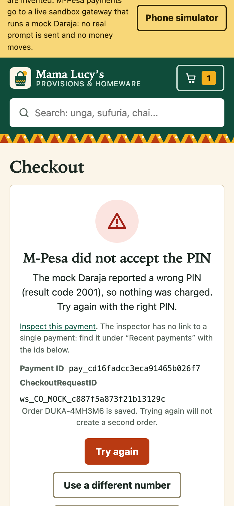
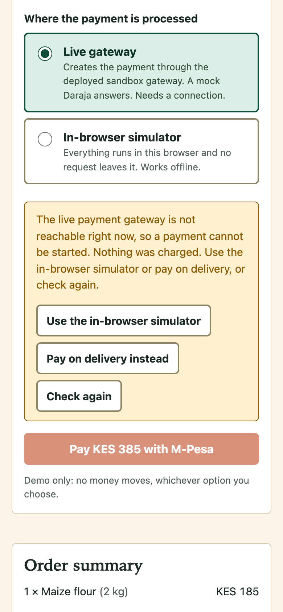
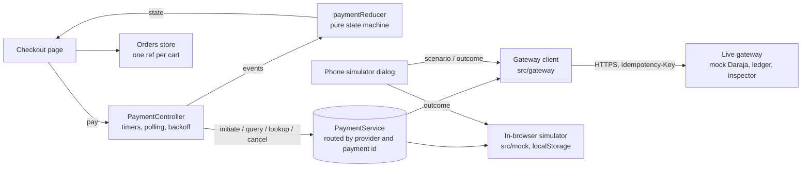

# Duka Storefront

**Live demo: https://victor-wambua.github.io/duka-storefront/**

A fast, accessible, mobile-first shop front-end for a small Kenyan retailer, with a checkout built around **M-Pesa STK push**: the way customers actually pay.

[](https://github.com/Victor-Wambua/duka-storefront/actions/workflows/ci.yml)
[](LICENSE)


> **Static demo, invented data, sandbox payments.** The shop, products, prices and stock are fictional ("Mama Lucy's Provisions & Homeware"). By default the checkout creates its payments on a **live sandbox gateway** ([mpesa-gateway](https://github.com/Victor-Wambua/mpesa-gateway)) whose Daraja side is a **mock**: the payment record, idempotency, status checks and ledger are real, the M-Pesa prompt is not. No real prompt is sent to any phone, no call is made to Safaricom and no money moves. An in-browser simulator (`src/mock/`) is the offline fallback and keeps working with no network. Status: portfolio build.


## The problem

Generic e-commerce templates assume a card form and a synchronous "paid or declined" answer. In Kenya most people pay with an M-Pesa prompt on their phone, and that is asynchronous: the customer has to pick up the handset, and may cancel, ignore it, mistype the PIN, or lack the balance. Templates handle this badly. The usual symptoms are a spinner that never ends, a second charge when the shopper taps "Pay" again, and an order that was paid for but never recorded.

This project is a working answer to that: the payment is a state machine, every ending has its own screen, retries cannot create a second order or a second charge, and there is a recovery path for "I paid but it still says pending".

## What it does

- **Catalogue.** 41 products in 6 categories, variants (size, colour, pack) with their own price and stock, instant fuzzy search that tolerates typos ("sufria" finds sufuria, "unga" finds maize flour), sorting, category filters, product pages, related items, recently viewed.
- **Pictures drawn in code.** No image files and no external requests: each product is an SVG composition coloured from its palette (or the chosen colour variant).
- **Cart.** Drawer with quantity steppers, stock limits, sample promo codes, delivery by Nairobi area or free pickup with an estimate, totals in whole shillings. Saved in `localStorage` with a schema version and a migration.
- **M-Pesa STK push checkout** (live sandbox gateway by default, in-browser simulator as the fallback): live phone-number normalisation (`07xx`, `01xx`, `+254...`), then a payment state machine with a countdown, polling with backoff, and a screen for each ending: paid, cancelled, wrong PIN, insufficient funds, declined, timed out, held for review, gateway unreachable, rate limited, over the demo cap, and "no answer in time".
- **No double charge, no duplicate order.** One order reference per cart, one idempotency key per attempt, double-click protection, and a rule that a new prompt is not offered until a status check shows nothing was paid.
- **Recovery.** "Check payment status" looks the payment up by order reference and phone. A reload mid-payment resumes the same prompt.
- **Pay on delivery** (or at pickup) as an alternative, receipts with print styles, order history, and order lookup by reference and phone.
- **Phone simulator.** The button in the yellow bar at the top opens a dialog with demo controls (Escape closes it). With the live gateway it is a scenario picker with a one-line explanation of each of the gateway's eight mock outcomes; with the in-browser simulator it also offers a delay slider and a simulated handset. Either way every state can be seen without a real phone.
- **PWA.** Installable, offline shell and catalogue, add-to-cart works offline, and checkout explains that it needs a connection.
- **Accessibility.** Landmarks, skip link, focus moved on route change and into/out of the drawer, live regions for cart changes and payment status, keyboard operable, reduced motion, dark mode, axe checks with real colour contrast.

| Cart | Waiting on the phone (live gateway, scenario picker open) |
| --- | --- |
|  |  |

| Wrong PIN (gateway) | Held for review (gateway) | Gateway unreachable |
| --- | --- | --- |
|  |  |  |

| No answer, then recovery (simulator) | Receipt (gateway payment) |
| --- | --- |
|  |  |

## Design notes

- Text is never smaller than 12px, including the lettering drawn on the product pictures. "Popular" and "New" are plain text above the product name, not badges.
- The whole product card is one link; the name link alone is at least 44px tall. Header, footer and breadcrumb links are 44px tall too.
- The category filter is a row of text tabs with the current one underlined and set in bold, and it is marked with `aria-pressed`.
- The checkout summary stays in view beside the form from 960px up. Validation puts the message under each field and moves focus to the first one that needs fixing. No field shows a realistic sample phone number as a placeholder.
- The phone simulator toggle sits in the demo bar, not over the page, so it cannot cover the Pay button or the footer links. The panel is a non-modal dialog with focus on open and on close.
- Not verified: screen reader output (VoiceOver, NVDA, TalkBack). Axe and keyboard checks only.

## Quick start

Needs Node 20.19 or newer (CI runs 22 and 24).

```bash
git clone https://github.com/Victor-Wambua/duka-storefront.git
cd duka-storefront
npm ci
npm run dev          # http://localhost:5173/duka-storefront/
```

Sample data is built in; there is nothing to load. Try this: add maize flour, open the cart, pick "Westlands, Kilimani & Lavington", apply `KARIBU10`, check out with phone `0700 000 001`, then use the **Phone simulator** button to pick "Customer cancels" and watch what happens.

```bash
npm run build && npm run preview   # production build (PWA service worker active)
```

## Live gateway

The checkout has a **payment provider switch** (in the payment section of the form, and at the top of the Phone simulator). The choice is saved in the browser.

| | Live gateway (default) | In-browser simulator |
| --- | --- | --- |
| Where the payment is created | `POST /v1/payments` on the deployed [mpesa-gateway](https://github.com/Victor-Wambua/mpesa-gateway) (Cloudflare Worker + D1) | `localStorage`, in this browser |
| Daraja side | A **mock** Daraja with deterministic scenarios. Nothing is sent to Safaricom or to a phone | A pretend handset |
| Needs a network | Yes | No |
| Receipt codes | `MOCK...` from the gateway | `SIM...` from the browser |

**What is real:** the HTTP API, the Idempotency-Key handling, the payment state machine, the callback and status-query verification, the append-only ledger and the inspector. **What is simulated:** the M-Pesa prompt and the customer's answer. A live Safaricom sandbox instance can be put behind the same API later; the storefront only knows the API.

How the storefront uses it:

- **Reference and idempotency.** The order number (`DUKA-XXXXXX`) is the payment `reference`. One `Idempotency-Key` is made per attempt and saved in the checkout session *before* the request goes out, so a double click or a reload that re-sends the request gets the same payment back (HTTP 200) instead of a second one. A new key is made only when the request body changed or the previous attempt got an answer. If the gateway reports a payment already in flight for the order (`reference_pending`), the checkout follows that one.
- **Polling.** `GET /v1/payments/:id` about every 1.5 s, easing off to 5 s. It stops when the payment is final, pauses while the page is hidden or the browser is offline, and waits out `Retry-After` on a 429.
- **Never paid early.** An order is marked paid only when the gateway says `succeeded`, and the receipt shown is the `mpesa_receipt` from that response. `needs_review` is its own screen ("We are checking this payment"): the order stays unpaid, the visitor is told not to pay again, and can check again, open the order, or choose pay on delivery.
- **Timeouts.** After the gateway marks a payment `timed_out` the checkout keeps watching for 30 s, because a late success moves it to `needs_review` rather than `succeeded`.
- **Inspect this payment.** The gateway's inspector has no deep link to one payment, so the link goes to the inspector home and the page shows the payment id and Daraja `CheckoutRequestID` to find under "Recent payments".
- **Order lookup.** For a gateway order the order page and the orders page ask the gateway by `reference` (`GET /v1/payments?reference=`), only counting a payment whose amount matches the order, and they show "Payment under review" when the gateway is holding it.
- **When it cannot be used.** If the gateway is unreachable, rate limited (with the `Retry-After` countdown) or the cart is over the **KES 1,000** cap of the public demo key, the page says so in plain words, changes nothing, and offers the in-browser simulator or pay on delivery.

The Phone simulator's choices map onto the gateway's `scenario` values:

| Choice | `scenario` | Ends as |
| --- | --- | --- |
| Customer pays | `success` | `succeeded` after about 3 s |
| Insufficient funds | `insufficient_funds` | `failed` (code 1) |
| Wrong PIN | `wrong_pin` | `failed` (code 2001) |
| Customer cancels | `cancelled_by_user` | `cancelled` (code 1032) |
| Prompt times out (no callback) | `timeout_no_callback` | `timed_out` after about a minute |
| Duplicate callback | `duplicate_callback` | `succeeded`, recorded once |
| Late success | `late_success` | `timed_out`, then `needs_review` (about two minutes) |
| Callback and query disagree | `callback_then_query_disagree` | `needs_review` |

**Privacy.** The phone number you type is sent to the gateway (it returns it masked). In its mock mode it never sends a real prompt, so use a made-up number such as `0700 000 001`.

**No secret in this repo.** A static browser app cannot keep a secret. `src/gateway/config.ts` holds the gateway URL and the gateway's *publishable* demo key (`pk_sandbox_...`), which is public by design: it can only create sandbox payments up to KES 1,000, read its own payments, and nothing else. Override both at build time with `VITE_GATEWAY_URL` and `VITE_GATEWAY_KEY`. The gateway is rate limited (20 payments a minute per IP, 5 per phone number per 10 minutes).

## How it works



The payment lives in three layers so each can be tested alone:

1. `src/payment/machine.ts`: a pure reducer. `idle -> requesting -> awaiting_customer -> paid | failed(cancelled | wrong_pin | insufficient_funds | timeout | declined | unreachable | rate_limited | over_cap | rejected) | review | expired`. Events that make no sense in the current state return the same state object, which is how double-submits and late replies are ignored.
2. `src/payment/controller.ts`: owns time and I/O. Sends the push, polls with backoff (the simulator: 2, 3, 4.5, 6, then every 8 seconds; the gateway: 1.5 s easing to 5 s), enforces the wait window, pauses while offline or hidden, honours `Retry-After`, and drops replies that belong to an older attempt.
3. `src/payment/types.ts`: the `PaymentService` interface, with two implementations behind `src/payment/router.ts`: `src/gateway/service.ts` (the live gateway over HTTP, mapping its payment object to the states above) and `src/mock/mpesaMock.ts` (in the browser). A payment always goes back to the backend that created it, told apart by its id. The server-side counterpart for real Daraja is my [daraja-php](https://github.com/Victor-Wambua/daraja-php) library.

Money is always an integer number of shillings; percentages round half up using integer arithmetic. More in [docs/CASE-STUDY.md](docs/CASE-STUDY.md).

## Testing

```bash
npm run lint         # ESLint
npm run typecheck    # tsc --noEmit, strict
npm test             # Vitest: unit + component + axe (jsdom)
npm run test:e2e     # Playwright (builds, serves on :4210)
```

Last full run on this repo: **323 Vitest tests in 16 files, all passing; 18 Playwright tests, all passing; ESLint and `tsc` clean.** None of them calls the live gateway: unit tests stub `fetch`, Playwright stubs it with `page.route` and blocks the real host by default. Playwright needs a browser once: `npx playwright install chromium` (or set `CHROME_PATH` to an existing Chrome).

| Area | What is covered |
| --- | --- |
| Pricing | rounding, promo caps and minimums, free-delivery thresholds, totals always the integer sum of their parts, Nairobi-time delivery estimates |
| Phone numbers | 11 accepted formats, 14 rejections, masking |
| Payment machine | every transition, all five failure reasons, expiry, recovery, double-submit, stray events |
| Controller (fake timers) | backoff schedule, deadline, offline pause, reload resume, stale replies, cancel then retry |
| Mock service | every simulator outcome, idempotency, no stacked prompts, already-paid |
| Live gateway client and service | request and header shapes, `Retry-After`, every error mapped, timeouts, every status mapped (only `succeeded` is success), lookup by reference, routing by payment id |
| Live gateway checkout (stubbed `fetch`) | reference and Idempotency-Key, double click and reload, each ending's copy, late success and disagreement held for review and never paid, unreachable, rate limited, over the cap, scenario picker, order lookup, axe |
| Cart and persistence | reducer, stock limits, v1 to v2 schema migration, corrupt and future-version data |
| Components (Testing Library) | search, filters, variants, drawer focus, steppers, promo, every checkout state, offline, pay on delivery, order lookup |
| Accessibility | axe in jsdom on shop, product, drawer, checkout, payment panels, orders, receipt (0 violations); axe in Chromium with real colour contrast in light and dark (0 violations) |
| End to end | simulator: browse, add, STK success; cancel, retry, success with one order and one payment; reload mid-payment; pay on delivery. Gateway (stubbed): success, wrong PIN then retry, reload mid-payment, timeout, needs review, unreachable then simulator, rate limited, over the cap. Offline checkout message and the simulator as the offline fallback |

A Lighthouse run (v13, mobile profile with simulated throttling) against the local production build scored 100 for performance, accessibility, best practices and SEO, with LCP 0.8 s and no layout shift. That was a single run on a laptop against `vite preview`, not a field measurement.

**Bundle size** (gzip): shop route about 94 kB JavaScript + 6 kB CSS. Checkout, receipt, orders and the simulator are separate chunks that load on demand (checkout about 11 kB).

## Project layout

```
src/
  payment/    machine.ts (reducer), controller.ts (timers, polling), types.ts (service contract), router.ts (gateway or simulator)
  gateway/    config.ts (URL, publishable key), client.ts (HTTP), service.ts (gateway -> checkout states), scenarios.ts, copy.ts
  mock/       mpesaMock.ts (offline fallback: fake Safaricom + our server), PhoneSimulator.tsx (demo overlay)
  lib/        money, phone, pricing, search (fuzzy), persist (versioned localStorage)
  state/      cart reducer, orders, stores, cart view
  data/       sample catalogue, delivery fee table, promo codes
  components/ ProductArt (SVG illustrations), CartDrawer, PaymentPanel, ...
  pages/      Shop, Product, Checkout, Order (receipt), Orders (history + lookup)
sw/           service worker source (precache list injected at build)
tests/        Vitest
e2e/          Playwright
docs/         CASE-STUDY.md, screenshots/
```

## Configuration

| Variable | Default | Meaning |
| --- | --- | --- |
| `BASE_PATH` | `/duka-storefront/` | URL base used at build time. Set it when hosting under a different path. |
| `VITE_GATEWAY_URL` | the deployed demo gateway | Base URL of the payments gateway. |
| `VITE_GATEWAY_KEY` | the gateway's publishable demo key | Browser-safe key sent as `Authorization: Bearer`. Never put a secret key here: it would ship to every visitor. |

The router is a hash router on purpose: it works on static hosting under any sub-path with no server rewrites.

## Status and roadmap

Portfolio build. Everything described above exists and is tested. What is **real**: the payments gateway the checkout calls by default, its idempotency, state machine, verification and ledger. What is **mocked**: the shop, products and stock; Daraja behind the gateway (callbacks, the handset, receipt codes starting `MOCK`); and the in-browser simulator (receipt codes starting `SIM`). Result codes follow what I know of Daraja's STK callback but were **not checked against the real Safaricom sandbox**, and this front-end has never run against it.

Known limits: orders live in one browser only; stock is a local ledger, not a shared inventory; there are no user accounts; the delivery fees and promo codes are samples; the search is a small hand-written matcher, fine for a few hundred products, not thousands.

Next steps:

1. Point the gateway at the real Safaricom sandbox (it is built for that; nothing changes in this front-end), and verify the result codes against it.
2. Server-side orders and stock reservation, so two shoppers cannot buy the last item.
3. Swahili translation.
4. Web push for "your order is on its way".
5. Playwright runs on a real mobile browser matrix.

## Author

Built by Victor Wambua: [portfolio](https://victor-wambua.github.io/victor-portfolio/) · [case studies](https://github.com/Victor-Wambua/case-studies)

Licensed under the [MIT License](LICENSE).
