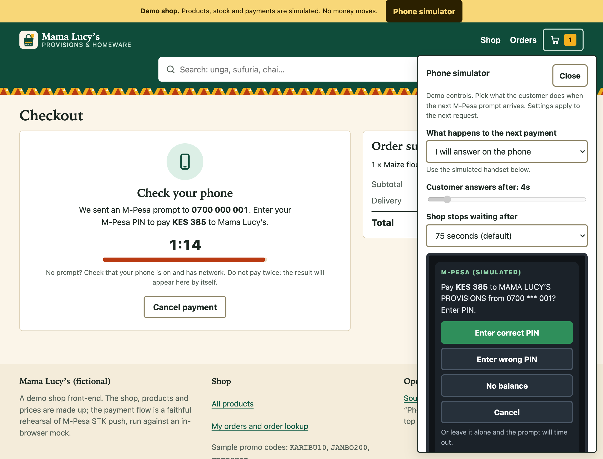

# Case study: Duka Storefront

*Async payment UX for M-Pesa STK push, as a state machine.*

## The problem

I build and look after systems that take money in Kenya, so I see the same failure again and again in shop front-ends. They are written for cards: press Pay, wait one second, get "approved" or "declined". M-Pesa STK push is not like that. The shop asks Safaricom to put a prompt on the customer's phone, and then nothing is known until the customer acts. They can accept, cancel, mistype the PIN, have too little balance, ignore it, or have no signal. The answer can also arrive late.

Small retailers feel this as lost money and support calls: a spinner that never ends, a double charge, or an order that was paid for but never marked paid. The shopper copes by sending an M-Pesa SMS screenshot on WhatsApp. This project is my attempt at a front-end that does not need the screenshot.

## Goals and non-goals

**Goals**

- Every ending of an STK push is its own screen with a clear next step.
- No second order and no second prompt by accident.
- A way out of "I paid but it still says pending" that does not involve paying again.
- Light and fast on a cheap phone (360 px first), installable, browsable offline, and accessible.

**Non-goals**

- A real shop backend, inventory or live payments. The shop is fictional. By default payments go to a live sandbox gateway whose Daraja side is a mock (or to an in-browser simulator offline). An opt-in third choice sends a real prompt through Safaricom's Daraja sandbox for a flat KES 1 test charge.
- Accounts, reviews, admin screens.
- Proving how the live Daraja API behaves beyond what was observed. The mock models the shape of the problem; the sandbox option has been seen to cancel, to time out, and (twice, a small sample) to succeed with a PIN.

## What I built

A React 19 + TypeScript (strict) + Vite shop with about 41 sample products, a cart drawer, a checkout, receipts, order history and a PWA shell. The payment code sits behind a small interface, `PaymentService`, with four calls: `initiateStkPush`, `queryStatus`, `cancel` and `lookupPayment`. Three providers sit behind it: a client for my live sandbox payments gateway ([mpesa-gateway](https://github.com/Victor-Wambua/mpesa-gateway), mock Daraja, publishable demo key), a client for a second instance of the same gateway that talks to Safaricom's real Daraja sandbox (opt-in, behind a warning and an acknowledgement, a flat KES 1 test charge), and an in-browser mock that stays as the offline fallback. A "phone simulator" overlay lets a reviewer choose what the customer does (the gateway's eight mock scenarios, or the browser simulator's outcomes); the sandbox has no picker because Safaricom decides.

## Design decisions and trade-offs

### 1. The payment is a pure state machine, and "expired" is its own state

`idle -> requesting -> awaiting_customer -> paid | failed(reason) | expired`.

The reducer in `src/payment/machine.ts` has no timers and no I/O; a separate controller owns those. So the whole transition table, every failure branch included, is tested without a clock, and the controller is tested with fake timers.

The decision I care most about is `expired`. Cancelled, wrong PIN, no balance and "prompt timed out" are all answers from Safaricom. They mean "nothing was charged". But if my own wait window ends without any answer, I do not know what happened. Treating that as a failure invites a second payment on top of a first one that is still in flight. So `expired` has no retry button. It offers "Check payment status", and a new prompt only appears after a lookup says nothing was found. The reducer enforces this: a `submit` event from `expired` is ignored unless the check came back `not_found`. A single "failed" state with a retry button, as most templates have, loses because it puts the double charge one tap away.

### 2. Idempotency on two levels

A retry must not create a second order. Two rules:

- **One order reference per cart.** The first press of Pay creates the order (`DUKA-XXXXXX`) and a checkout session saved in `localStorage`. Retries reuse it. If the cart changes, the old order is abandoned and a new one starts (a fingerprint of lines, promo, area and total decides).
- **One idempotency key per attempt**, `orderRef:attempt`. The mock service returns the same checkout request for a replayed key. It also refuses to stack a second prompt while one for the same order is still live, and answers `already_paid` if the order has a payment.

The second rule exists because the first is not enough. If the reply to a push is lost, the client does not know the request was sent, so it retries with a new attempt number and a new key. Only an order-level check on the server catches that. Daraja itself has no idempotency key, so a real backend has to provide both rules.

`finalizePaid` is also safe to call repeatedly (reload, lookup, late callback): only the first call changes the order and sells stock.

### 3. Money is integer shillings, rounded in one place

Prices, discounts, delivery and totals are whole numbers. A percentage discount is `floor((amount * pct + 50) / 100)`, so half rounds up with no floating point. The total is asserted in a test to equal subtotal minus discount plus delivery for every combination of area, promo and a spread of unit prices. `formatKES` throws on a fractional amount, so a bug shows up as an error rather than as "KES 99.5". One subtle rule is tested explicitly: free delivery is judged on the subtotal after discount, so a promo can bring an order back under the threshold.

### 4. Hash router, no router-level server needs

The demo is on GitHub Pages under `/duka-storefront/`. History-API routes would 404 on reload there. I chose a hash router over a `404.html` redirect trick because it has no moving parts and works under any base path. The cost is uglier URLs, and a skip link that cannot be a plain `#main` anchor (it would change the route), so it moves focus in a click handler.

### 5. Performance budget: small by construction, not by tuning

No UI library, no CSS framework, no icon font, no images, no web fonts: about 25 kB of hand-written CSS on design tokens (6 kB gzip), and product art generated as SVG. The shop route is about 94 kB of JavaScript gzip, mostly React and the router; checkout, receipts, orders and the simulator load on demand. I rejected TanStack Query and a state library: a `useSyncExternalStore` over a small versioned `localStorage` store covers everything in about 100 lines. One Lighthouse run against the local production build gave 100 in all four categories, LCP 0.8 s, no layout shift. That is a lab number on a laptop, not what a customer on a 3G phone would see.

### 6. Offline: be honest about what works

A hand-written service worker precaches the shell and every built asset, so the catalogue (it is in the bundle) and add-to-cart work offline. Checkout is disabled offline with an explanation: pretending to pay without a connection is worse than saying so. A real bug here: the lazy checkout chunk was cached but the lookup missed it, because the server sent `Vary: Origin` and module scripts send an `Origin` header. It worked online and failed offline, and only the e2e test showed it. The lookup now ignores `Vary` for static assets.

## How it is kept correct and safe

- **Tests.** 204 Vitest tests and 8 Playwright tests, listed in the README. Nothing touches the network.
- **Bugs the tests caught while I built it:** typing in the search box lost focus because the page heading grabbed it on every query change; a fake-timer test that never advanced because the mock had captured the real `Date.now` at import; a service worker whose placeholder was replaced inside a comment instead of the code; and a nested `<form>` in checkout.
- **Persistence.** Everything saved in the browser is `{ v, data }`. Older versions migrate one step at a time; corrupt or newer data falls back to empty instead of crashing.
- **Input and privacy.** Phone numbers are normalised and checked at the boundary (`+254 0712...` slips included); the mock rejects fractional amounts and malformed numbers like a real server should. No real data, no secrets; phone numbers are masked on receipts.
- **Accessibility.** The payment panel moves focus to the heading on progress states and to the primary action on failures, with `role="alert"` for failures and a polite live region for the countdown (announced every 15 seconds, not every second).

## How the mock maps to the real Daraja flow

| Mock | Daraja (as I understand it) |
| --- | --- |
| `initiateStkPush` | `POST /mpesa/stkpush/v1/processrequest` returns `MerchantRequestID` and `CheckoutRequestID` |
| `queryStatus` | STK Push Query, which can answer "still being processed" |
| result codes 0, 1, 1032, 1037, 2001 | the `ResultCode` in the callback: success, insufficient balance, cancelled, timed out, wrong PIN |
| `lookupPayment` | your own ledger, fed by the callback to your `CallBackURL` |
| `delayed_paid` outcome | the callback or query lagging behind the money |

The callback is the source of truth in production; polling is a fallback. In the browser mock there is no callback, so `lookupPayment` stands in for "what my server recorded". Daraja has no cancel call, so the mock's `cancel` is a mock convenience: a real client would stop waiting and rely on the order-level duplicate check. The server-side half (OAuth, password and timestamp, callback handling, signature and replay checks) is what my [daraja-php](https://github.com/Victor-Wambua/daraja-php) library is for. I have not run this front-end against the live or sandbox API, and I have not verified the result codes against current Daraja documentation.

## What I'd do differently, and what's next

- Put the order and stock on a server. A local ledger is fine for a demo and wrong for two shoppers and one last item.
- Replace polling with server-sent events once a backend receives the callback.
- Start with a message catalogue so Swahili is not a retrofit.
- Run the e2e suite on real mobile browsers, not only a Chromium device profile.

## Status

Portfolio build. It runs locally and as a static demo with sample data. The shop, products, prices, stock, delivery fees and promo codes are simulated. By default payments are created on a live sandbox gateway whose Daraja side is a mock: the handset, the callbacks and the receipt codes (`MOCK...`, or `SIM...` from the browser simulator) are synthetic, and no money moves. The opt-in Safaricom sandbox provider is different: it is not simulated. It has sent a real prompt to the owner's own phone, and the real results seen were ResultCode 1032 (cancelled by the customer, callback after about 8 seconds) and 1037 (no response, callback after about 26 seconds, mapped to timed out). The owner has completed two KES 1 payments with a PIN. The first went through the gateway directly (success callback after 9 seconds with ResultCode 0, confirmed by the gateway's STK Query on the second try, then marked succeeded with a balanced journal). The second went through this storefront's sandbox option: a first attempt was cancelled, a retry succeeded, and the gateway's status query confirmed the receipt. That is two payments, still a small sample. This project has not checked whether a sandbox success debits a real wallet. The storefront's success path is covered only by tests against a stubbed gateway.
